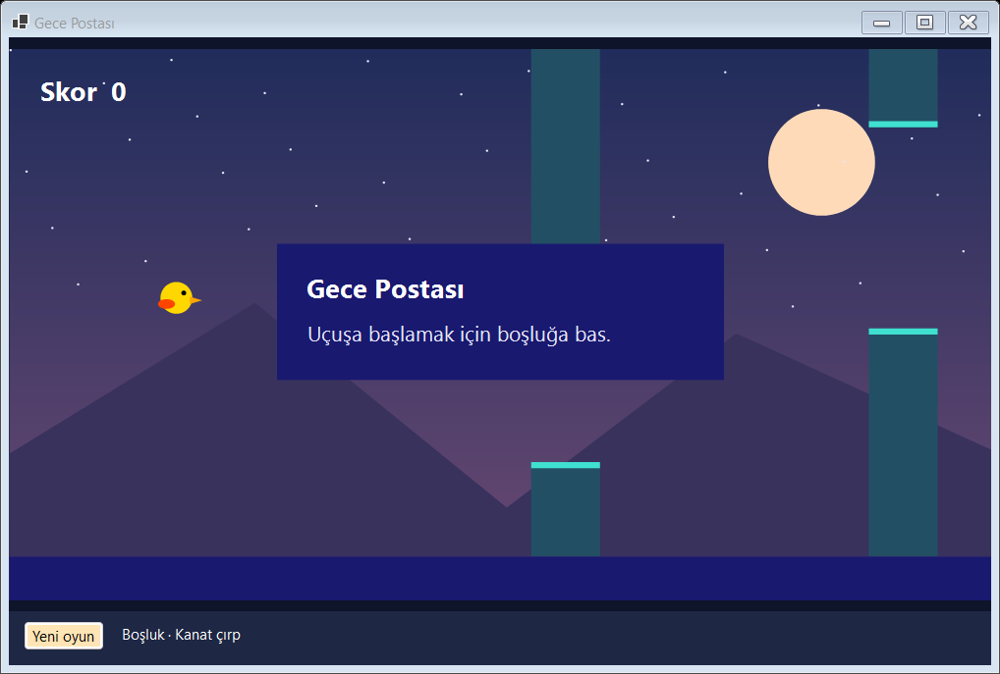
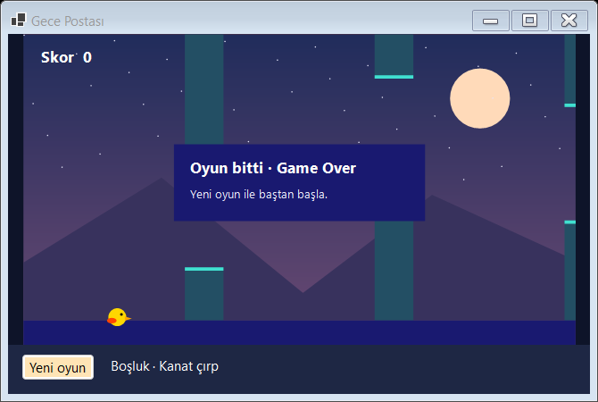

# Gece Postası

Gece manzarasında geçitlerden geçen bir posta kuşunu yönettiğin özgün bir uçuş oyunu.

## Teknoloji

C# / .NET 10, Windows Forms, GDI+ ve Windows Forms Timer.

## Kurulum ve çalıştırma

Windows, Git ve .NET 10 SDK gerekir. Visual Studio kullanıyorsan **.NET masaüstü geliştirme** iş yükünü kur.

```powershell
git clone https://github.com/ayhamhammoud1/YMH219-FlappyBird.git
cd YMH219-FlappyBird
```


```powershell
dotnet restore
dotnet run
```

## Özellikler

- Boşluk tuşuyla uçuşu başlat ve kuşu yükselt. Tuş bırakıldığında yer çekimi etkisi sürer.
- Üç geçit sağdan sola hareket eder, ekran dışına çıkınca yeniden sıraya girer.
- Her geçit bir puan kazandırır. Zemine, tavana veya geçide çarpınca oyun durur.
- **Yeni oyun** skoru ve uçuşu sıfırlar. Çizim pencereye oranlı ölçeklenir.

## Ekran görüntüleri





## Sınırlamalar

Rekorlar oturum dışında saklanmaz.

## Yerel test sonuçları

Yerel doğrulama: boşluk tuşu uçuşu başlattı, oyuncu yer çekimiyle düştü, zemin ve geçit çarpışmaları oyunu durdurdu. Geçiş bir kez puanlandı. Geçit geri döndü, yeniden başlatma skoru sıfırladı ve oyun alanı küçülen pencereye sığdı.

## Öğrenci

Ayham Nawaf Hammoud — 240541613
